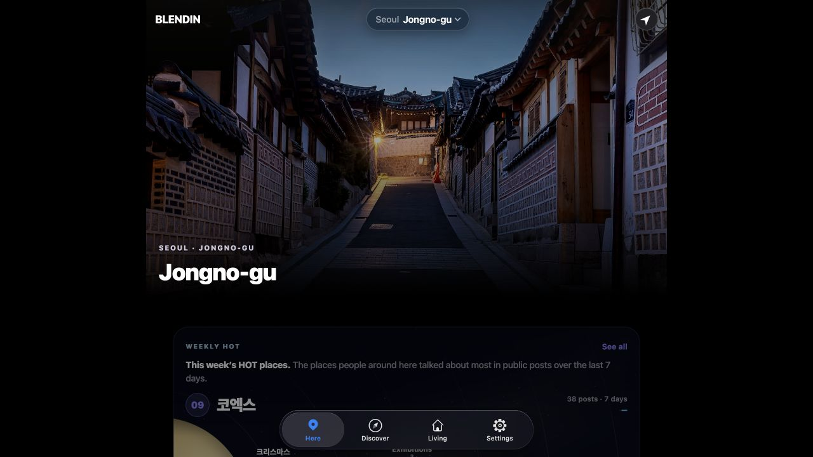
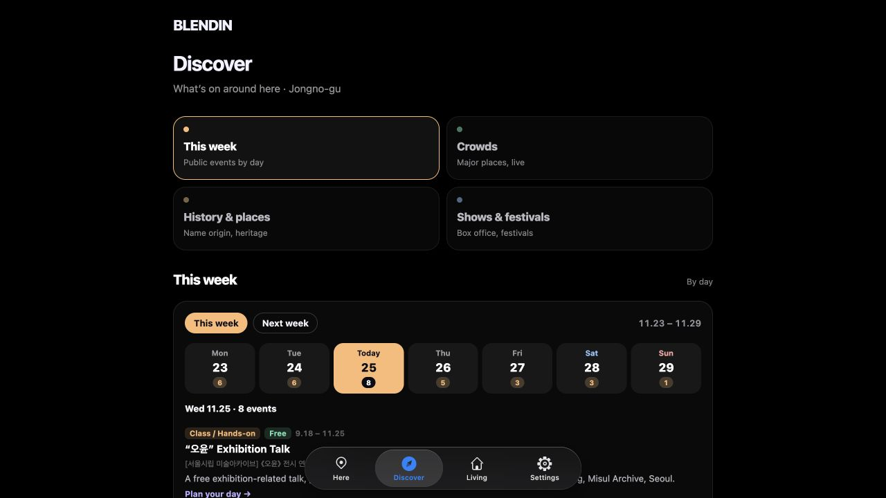
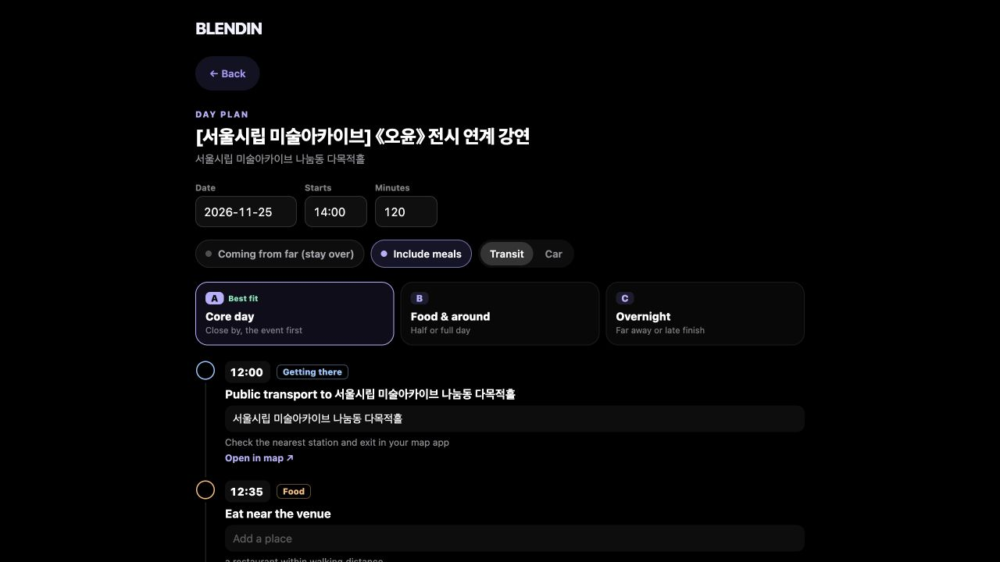
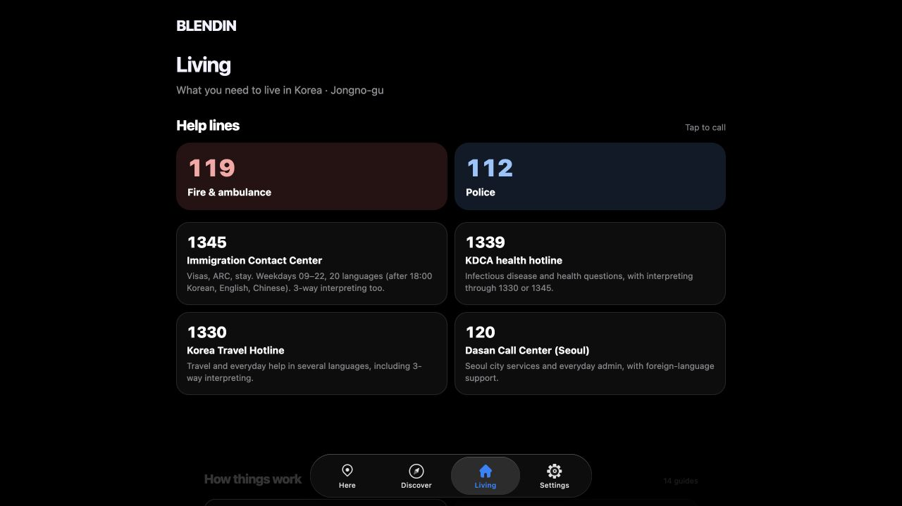
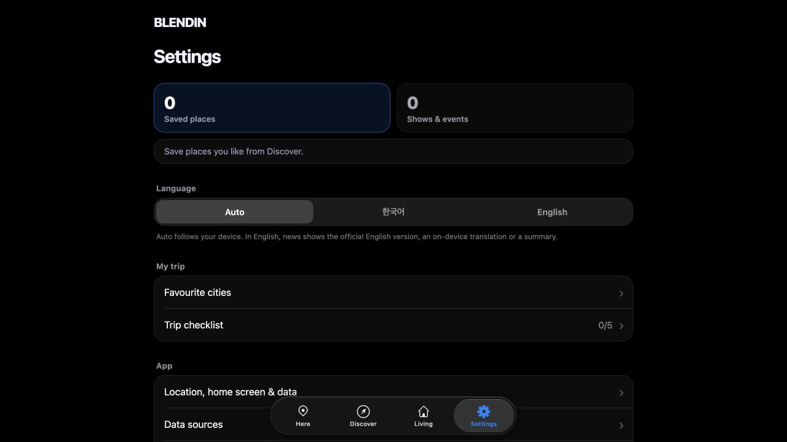
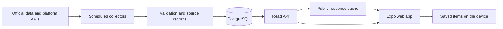

# BLENDIN

A web app for people getting to know a new place: what is happening nearby, how daily life works, and how to join in.

[Open the app](https://blendin.pages.dev/) · [Watch the walkthrough](media/blendin-walkthrough.mp4)



## Why I am building it

The question behind BLENDIN is simple: how can someone new to an area feel more at home there? Local events are a starting point, but so are knowing how to get around, understanding everyday routines, and having enough context to take part.

I am bringing those pieces into one place. You can find an event, make a draft plan around it, and look up practical guidance without switching between unrelated services.

## Try it

1. Open **Here** and choose an area.
2. Go to **Discover** to browse events by day. Open **Plan your day** from an event to try the itinerary options.
3. Open **Living** for everyday guidance, then **Settings** to switch between English and Korean.

## Screens

| Find something to join | Build a day around it |
| --- | --- |
|  |  |

| Settle into daily life | Keep useful information close |
| --- | --- |
|  |  |

The [silent walkthrough](media/blendin-walkthrough.mp4) follows these screens and shows a second itinerary option alongside the everyday-life and language settings screens. It is assembled from captures of the running web app on 25 November 2026.

## My contribution

I set the product goal, chose the feature priorities, and directed the navigation and visual revisions. I worked through data-source setup, integration decisions, and checks against the running app.

Some decisions I kept returning to:

- Put local discovery and useful daily-life information in the same product.
- Keep the first view short and reveal details when someone opens a card or guide.
- Show an event's original title alongside the English explanation so it is easier to look up locally.
- Keep observed activity separate from claims about an entire area's culture.

I use AI coding tools during development. Product direction and feature decisions are mine.

## How it is built

The interface uses TypeScript, React Native and Expo Router, including the web build. Cloudflare Pages serves the web app, while Supabase PostgreSQL and Edge Functions handle the data and API. Source integrations use official public-data and platform APIs. The development project also includes automated checks for data handling and API responses.

This repository contains the product presentation and media. Application source, credentials, collection configuration and unpublished technical documents remain in the private development repository.

### System structure



Collection runs separately from browsing. The server keeps provider credentials and prepares data for the read API. Selected public responses pass through an edge cache. Saved places, preferences and day plans are kept on the user's device.

### Application layout

The private development project is split by responsibility:

```text
mobile/src/app/          Screens and navigation
mobile/src/components/   Shared interface components
mobile/src/lib/          API requests, local state and display helpers
functions/v1/            Public read cache
supabase/functions/      Data API and collection jobs
supabase/migrations/     Database changes
server/test/             Data handling and API checks
supabase/test/           Database and Edge API checks
```

### Basic flows

**Regional discovery.** A selected area becomes part of the data request. The screen shows a loading state, then renders the available places, news or events. A failed request has an error state; an empty result is shown as empty. Observed counts describe the collected sample.

**Event to day plan.** An event supplies the starting context: its title, date and venue. The user opens a plan, chooses an option, edits times or places, and saves it on the device or copies it as text. Missing place information stays unconfirmed until the user checks it.

**Collection to display.** Configured collectors request provider data, validate fields and retain source identifiers so repeat collection can be handled without treating each response as a new item. The API serves the stored results for the selected area. Provider access and collection failures affect what can be shown.

## Current scope

BLENDIN is a working web app under active development. Data availability varies by area and provider, and observed post counts are a sample rather than a complete measure of local activity. Some event names and source text remain in Korean. Day plans are editable drafts; opening hours and actual travel times still need checking.

## About

Built by [Jehyun Sung](https://github.com/jehyun-sung).

Screens show the public BLENDIN interface. Event information, photographs and other third-party material retain their original providers' rights and attribution. Source links are available in the app.
